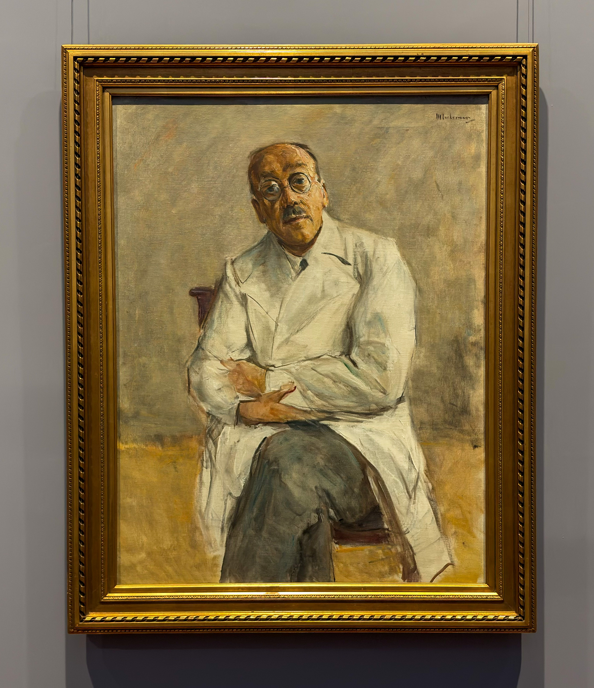
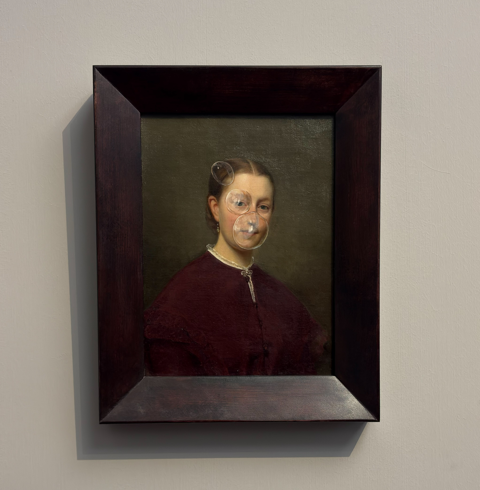

31 Ekim, Reformationstag olması nedeniyle Hamburg'da resmi tatildi. Bu tatilde, #seeforfree kapsamında yaklaşık 50 müze ücretsiz olarak ziyaret edilebiliyordu. Daha önce gittiğim Hamburger Kunsthalle'yi yeniden ziyaret etmek istedim. Bir müzeye her gittiğimde bir başka bölümü ya da başka bir ayrıntı ilgimi çekebiliyor. Bu defa da portreler ve portre sanatının zaman içindeki değişimi dikkatimi çekti.

Okuduklarıma göre 18. yüzyılda portre resminde yeni ve varlıklı orta sınıfın temsili portrelerine dayanan bir canlanma yaşanıyor. Belirli bir kişinin anısını canlı tutmak ve gelecek nesillerin hafızasında kalmasını sağlamak gibi geleneksel işlevinin yanı sıra, modeller daha klasik ve sade bir üslupla, samimi bir atmosfer içinde tasvir edilmeye çalışılıyor. Bununla birlikte izlenimciler kendi dönemlerinde portre geleneğinin temsil biçimini değiştirmeye çalışıyorlar. Modellerini sanki bir anlık fotoğrafta yakalanmış ya da tesadüfen kadraja girmiş gibi son derece doğal bir biçimde resmediyorlar. Özneler zaman zaman sert ve mesafeli görünseler bile, etraflarındaki desenli kumaşlar, duvar kâğıtları ve diğer ayrıntılarla sahneyi hareketlendiriyorlar. 

<figure>
    
    <figcaption style="color: gray; font-size: 15px;">Der Chirurg Ferdinand Sauerbruch, Max Liebermann</figcaption>
</figure>

Örneğin bu eserde, Alman empresyonist ressam Max Liebermann'ın 1932 yılında yaptığı Der Chirurg Ferdinand Sauerbruch portresi yer alıyor. Sanıyorum ki Ferdinand Sauerbruch, tıp tarihinde tanınan cerrahlardan biri. Portredeki doğal ve kendinden emin duruşu, müzenin odasında hemen dikkat çekiyor.

Bunun yanında Avusturyalı çağdaş sanatçı Markus Schinwald'ın Phoebe adlı eseri ise ayrıca dikkatimi çekti. Schinwald, genellikle antikacılardan veya müzayedelerden bulduğu 18. ve 19. yüzyıla ait klasik portreleri alıyor ve üzerlerine kendi müdahalelerini ekleyerek orijinal tabloların havasını kasıtlı olarak bozuyor. Geçmişin estetik portrelerine bugünden yapılan bu müdahale biçimini sevdim. Sanki geçmişten bugüne ulaşan bir yüz, bugünün sanatçısının dokunuşuyla yeniden yorumlanıyor.

<figure>
    
    <figcaption style="color: gray; font-size: 15px;">Phoebe, Markus Schinwald</figcaption>
</figure>

Müzede dolaşırken portrelerin yalnızca resmedilen kişileri değil, aynı zamanda farklı dönemlerin insana ve onun temsil edilme biçimine nasıl baktığını da göstermesi de hoşuma gitti. Bir zamanlar bir insanın yüzünü ve anısını gelecek nesillere aktarmak için yapılan portreler, bugün başka sanatçıların müdahaleleriyle yeniden anlam kazanabiliyor. Belki de portreleri ilginç kılan şey biraz da bu: Aradan geçen zamana rağmen bakmaya devam ettiğimiz yüzlerin, her dönemde bize başka bir şey anlatabilmesi.